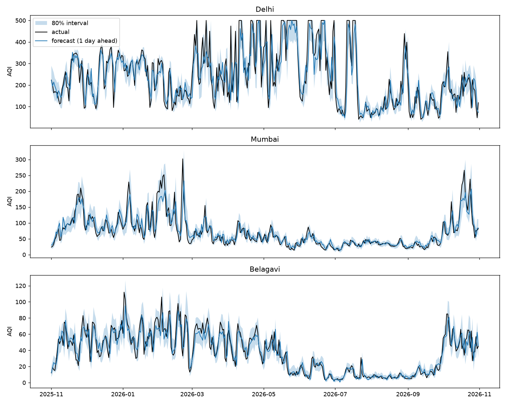
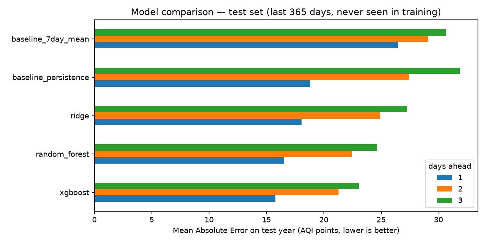
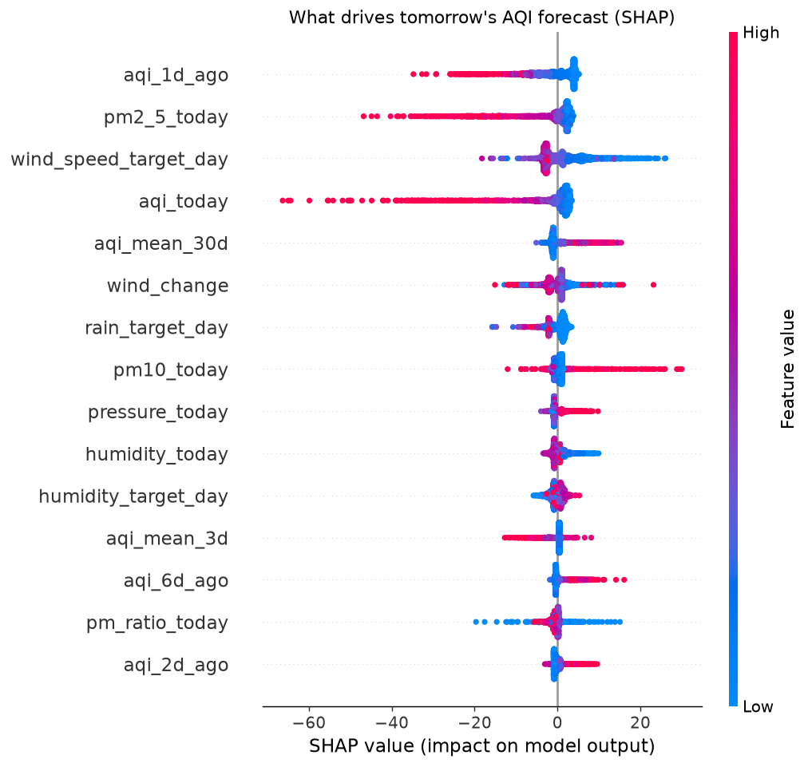
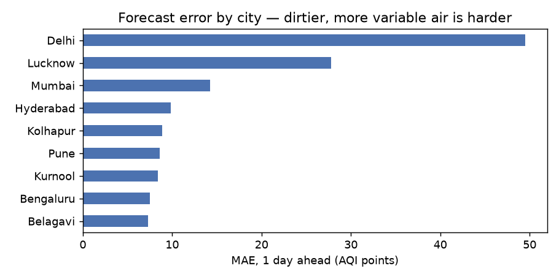

# 🌬️ VayuCast — Air-Quality Forecasting for Indian Cities

**An end-to-end machine-learning system that forecasts the Indian AQI 1–3 days ahead** for 9 cities: Belagavi, Kolhapur, Pune, Mumbai, Bengaluru, Hyderabad, Kurnool, Lucknow and Delhi. It covers data collection, feature engineering, model training, uncertainty, explanations, an API, a dashboard, automated retraining and live monitoring.

  

<!-- After deploying: add your live dashboard link here -->

---

## Why
Air pollution is one of India's largest health risks, yet AQI is usually reported *after* the air is already bad. A reliable forecast lets people plan outdoor activity, and lets schools and hospitals prepare.

## Results (held-out test year: Nov 2025 → Oct 2026)

| Days ahead | Avg. error (MAE) | vs. "same as today" baseline | Correct AQI category | R² |
|:-:|:-:|:-:|:-:|:-:|
| 1 | **±15.8 AQI** | **16% better** | 78% | 0.88 |
| 2 | ±21.3 AQI | 22% better | 72% | 0.81 |
| 3 | ±23.1 AQI | 28% better | 68% | 0.79 |



<details>
<summary><b>More charts: model comparison, SHAP, error by city</b></summary>




</details>

## Highlights
- **4+ years of data**: hourly pollution (PM2.5, PM10, NO₂, SO₂, O₃, CO) and weather for 9 cities, combined into daily rows with the **official CPCB AQI method**
- **Data-quality checks**: detects and repairs a nationwide sensor glitch (all cities ≈ 0 on the same days)
- **54 engineered features**: lags, rolling statistics, forecast weather for the target day, cyclical calendar, Diwali proximity
- **Honest evaluation**: time-based cross-validation for choosing models, a locked test year, and baselines. A built-in demo shows a shuffled split overstating accuracy (MAE 12.1 vs the true 15.8)
- **Leakage-proof**: an automated test scrambles all future data and checks that no feature changes
- **Uncertainty**: quantile XGBoost gives a likely range for every forecast
- **Explainability**: SHAP shows *why* each forecast was made (wind, rain, today's level, Diwali…)
- **Production**: FastAPI service, Streamlit dashboard, Docker, GitHub Actions for daily forecasts and weekly retraining
- **Monitoring**: logs every forecast and scores it once the day has passed; detects seasonal drift per city

## Architecture
```
Open-Meteo APIs ──► fetch_data ──► daily.csv ──► features ──► train ──► models/*.joblib
 (pollution +        (hourly →       (+ CPCB      (clean,       (CV, test,       │
  weather +           daily)          AQI)         54 features)  SHAP, MLflow)    │
  forecast)                                                                       ▼
                     ┌──────────── predict.forecast_city() ◄──────────────────────┘
                     │                    │                     │
               api/main.py          app/dashboard.py       src/monitor.py
               (FastAPI)            (Streamlit)            (log, score, drift)
                                                                 ▲
                         GitHub Actions: daily monitor · weekly retrain · tests on push
```

## Quick start
```bash
python -m venv .venv
.venv\Scripts\activate                 # Windows  (Mac/Linux: source .venv/bin/activate)
pip install -r requirements-dev.txt

python -m src.fetch_data               # download 4 years of data (~1 min)
python -m src.train                    # train and evaluate (~7 min)
python -m src.predict                  # live forecasts in the terminal

streamlit run app/dashboard.py         # dashboard  -> http://localhost:8501
uvicorn api.main:app --reload          # API        -> http://127.0.0.1:8000/docs
python -m src.monitor                  # log forecasts, score past ones, check drift
pytest                                 # run the 33 tests
```

## Adding a city
1. Add one line to `CITIES` in [`src/config.py`](src/config.py) with the name, latitude and longitude (from Google Maps).
2. `python -m src.fetch_data`, then `python -m src.train`. The model **must** be retrained, because each city has its own input column.

Cities were chosen to cover different air: home cities (Belagavi, Kolhapur), the polluted Indo-Gangetic plain (Delhi, Lucknow), the coast (Mumbai), the Deccan plateau (Pune, Bengaluru, Hyderabad, Kurnool).

## API
| Endpoint | Returns |
|---|---|
| `GET /health` | Service status and model version |
| `GET /cities` | Supported cities |
| `GET /forecast/{city}` | 3-day forecast with ranges, categories, SHAP drivers and 30-day history |
| `GET /metrics` | Test-set performance |

## Project structure
```
src/
  config.py       settings: cities, dates, paths, horizons
  fetch_data.py   download + hourly→daily (history and live)
  aqi.py          Indian AQI (CPCB breakpoints)
  features.py     cleaning, glitch detection, 54 features
  models.py       Ridge / Random Forest / XGBoost, change-based wrapper, quantile models
  train.py        cross-validation, test, leakage demo, SHAP, charts, MLflow, save
  predict.py      live forecasts and explanations (used by the API and dashboard)
  monitor.py      forecast log, live scoring, seasonal drift
api/main.py       FastAPI service
app/dashboard.py  Streamlit dashboard
tests/            33 tests (AQI, leakage, cleaning, drift, API)
notebooks/        Lesson 1: exploring the data
reports/          metrics.json, model_comparison.csv, figures/, monitoring.json
.github/workflows CI, daily forecast, weekly retrain
LEARNINGS.md      every concept in this project, explained from zero
```

## Deploying
- **Dashboard:** push to GitHub → [share.streamlit.io](https://share.streamlit.io) → New app → main file `app/dashboard.py`.
- **API:** any Docker host (Render, Railway, Fly.io): `docker build -t vayucast . && docker run -p 8000:8000 vayucast`.
- **Automation:** the GitHub Actions workflows start automatically once the repo is on GitHub (Settings → Actions → allow read/write permissions).

## Limitations (being honest)
- Pollution values come from the **CAMS atmospheric model** (via Open-Meteo), not CPCB ground stations. They're consistent and gap-free, but can differ from station readings.
- AQI uses **PM2.5 and PM10 only**. The official AQI uses up to 8 pollutants, but PM dominates in most Indian cities.
- For training, *observed* weather stands in for *forecast* weather on the target day. Real forecasts have errors, so live accuracy should be slightly worse than the test results. The monitoring job measures the real number.
- The 80% prediction ranges actually cover **73–76%** of days, so they're slightly over-confident. Conformal calibration is the planned fix.
- Delhi's AQI sometimes hits the 500 cap, where the scale stops telling severe days apart.

## Data sources
- [Open-Meteo Air Quality API](https://open-meteo.com/en/docs/air-quality-api) (CAMS, CC BY 4.0)
- [Open-Meteo Historical Weather](https://open-meteo.com/en/docs/historical-weather-api) and [Forecast](https://open-meteo.com/en/docs) APIs
- AQI method: Central Pollution Control Board (CPCB), India

---
Built by **Sahaj Alatage** · B.Tech CSE (AI & Data Science) · see [LEARNINGS.md](LEARNINGS.md) for the full write-up of everything learned
